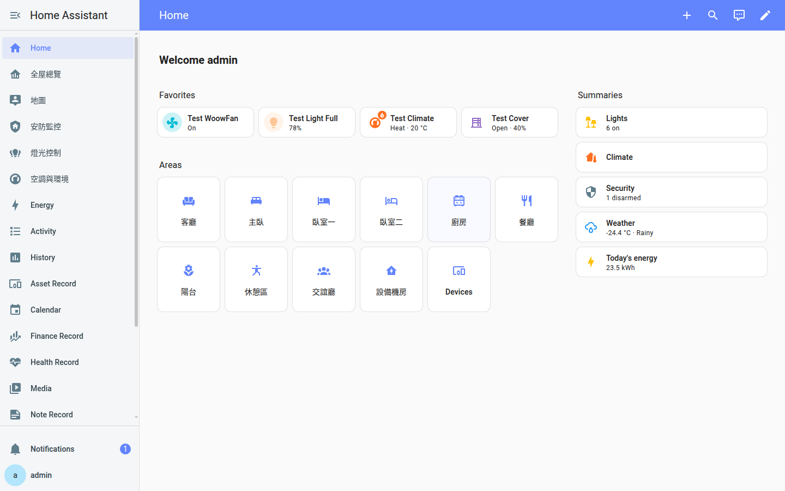
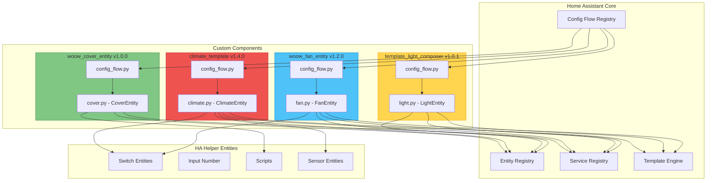
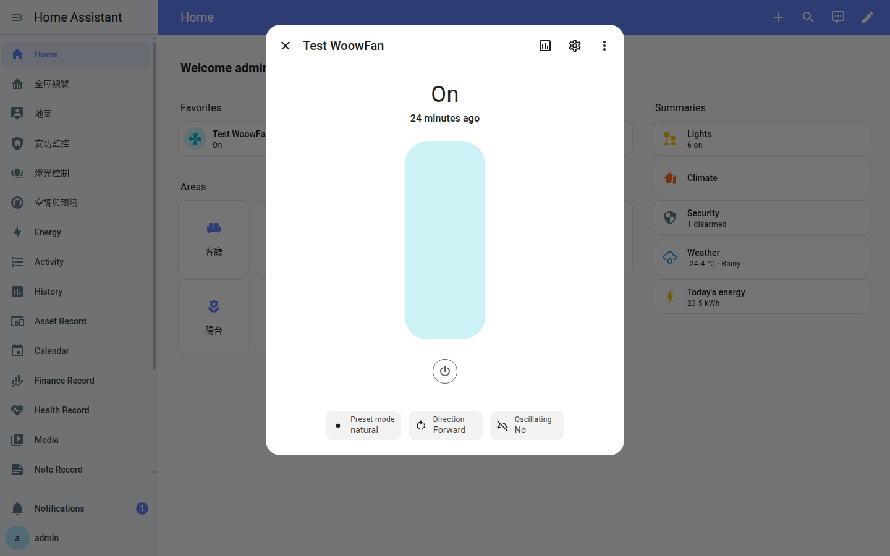
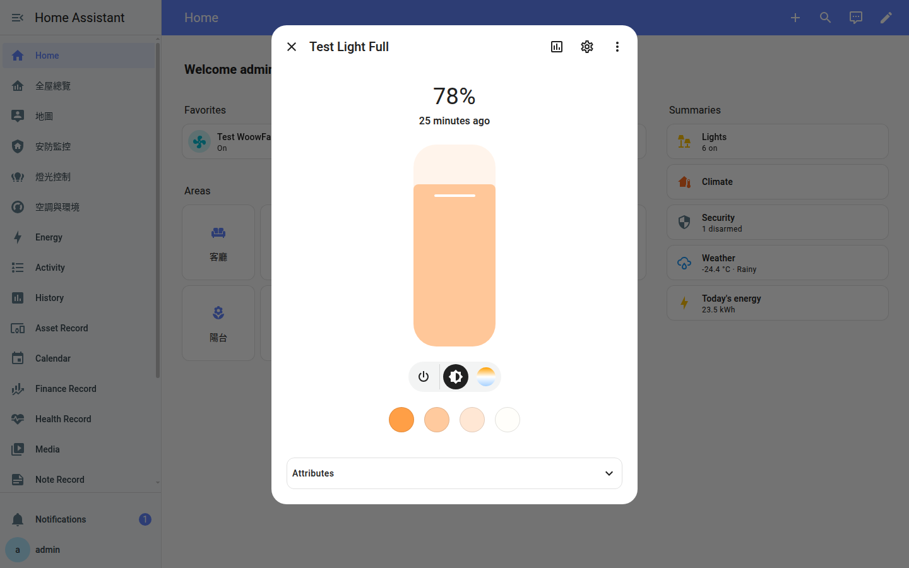
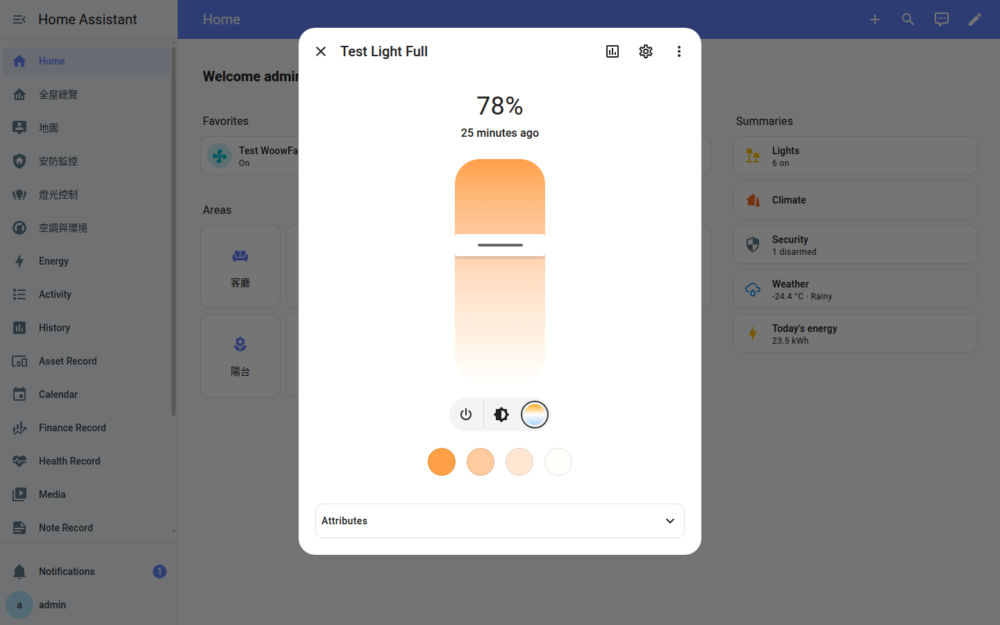
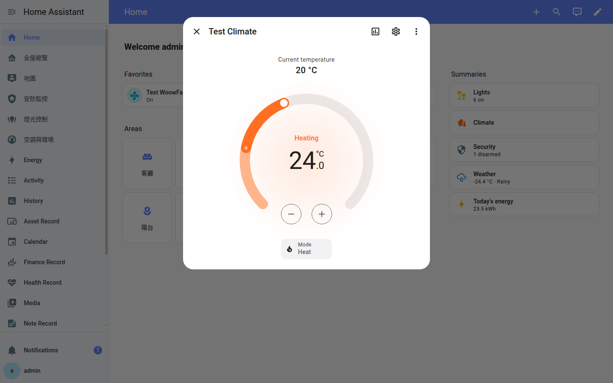
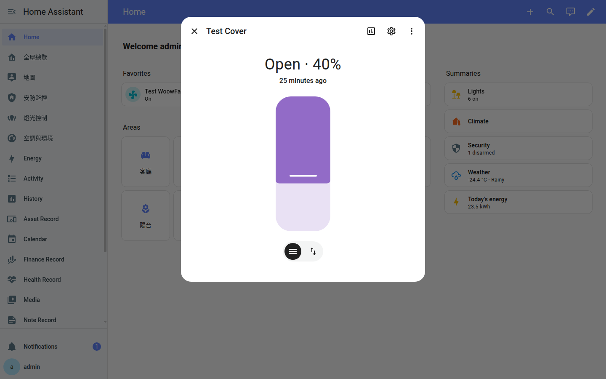
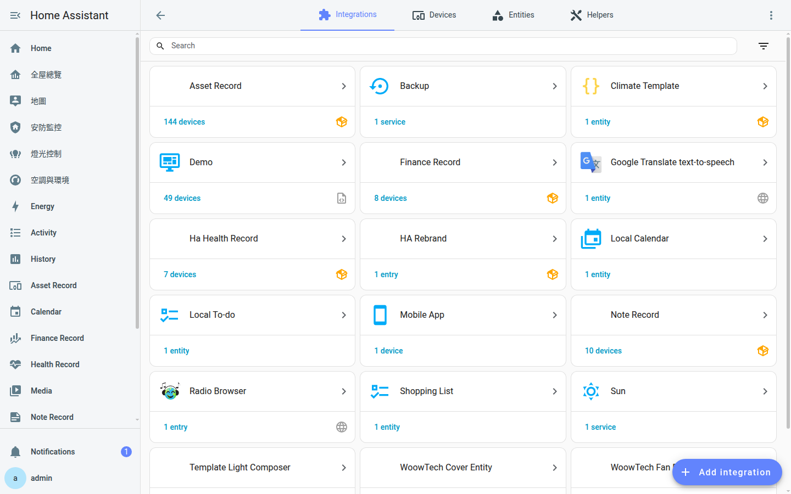
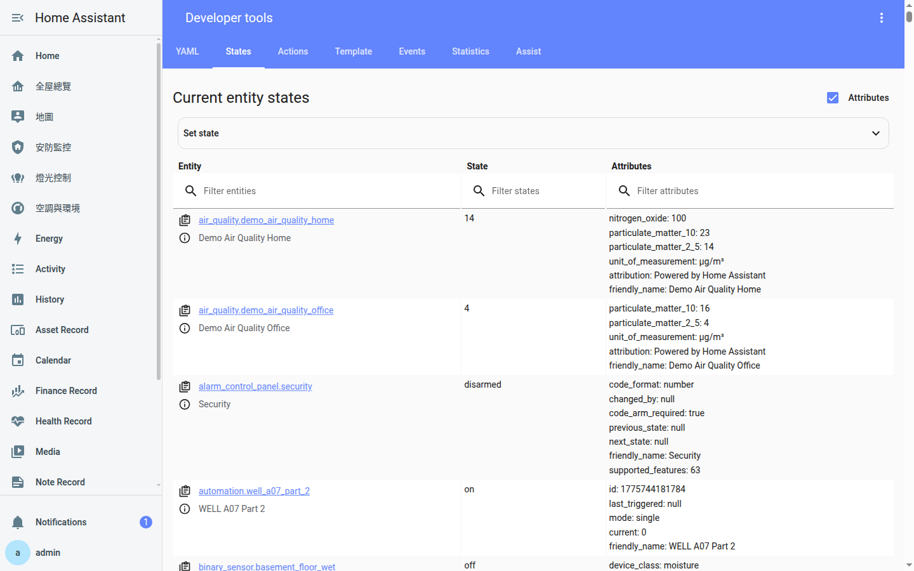

<p align="center">
  
</p>

<h1 align="center">Woow HA Entities Template</h1>

<p align="center">
  <strong>Enterprise-grade Home Assistant Custom Component Templates</strong><br/>
  Production-ready Fan, Light, Climate &amp; Cover entity integrations with Config Flow UI
</p>

<p align="center">
  <a href="#features">Features</a> &bull;
  <a href="#architecture">Architecture</a> &bull;
  <a href="#installation">Installation</a> &bull;
  <a href="#modules">Modules</a> &bull;
  <a href="#screenshots">Screenshots</a> &bull;
  <a href="#configuration">Configuration</a> &bull;
  <a href="#testing">Testing</a> &bull;
  <a href="#api-reference">API</a> &bull;
  <a href="README_zh-TW.md">中文文件</a>
</p>

<p align="center">
  
  
  
  
  
</p>

---

## Overview

**Woow HA Entities Template** is a collection of four enterprise-grade Home Assistant custom component templates, covering the most common smart home entity types: **Fan**, **Light**, **Climate**, and **Cover**. Each component features a full Config Flow UI, template-based state management, and has been validated through 152+ automated tests across 6 rounds of API functional, edge-case, stress, browser UI, persistence, and regression testing.

<p align="center">
  
</p>

### Why This Package?

| Challenge | Solution |
|-----------|----------|
| HA custom component boilerplate is complex and error-prone | Production-ready templates with best practices baked in |
| Config Flow setup is poorly documented for custom integrations | Full Config Flow UI with validation, error handling, and i18n |
| Template entities lack proper state management | Debounced state updates, template caching, and RestoreEntity support |
| No standard for testing HA custom components | 152+ automated tests covering functional, edge-case, stress, and UI layers |
| Hard to create virtual devices for development/testing | Instant virtual entity creation via Config Flow — no hardware needed |

---

## Features

### Core Capabilities

- **Config Flow UI** — All 4 components support full graphical setup via Settings > Integrations
- **Template-Based State** — Entity states derived from HA templates for maximum flexibility
- **RestoreEntity Support** — Climate entity persists state across HA restarts
- **Input Validation** — All config flows validate user input with clear error messages
- **i18n Ready** — `strings.json` with English labels, easily extensible to other languages
- **Enterprise Tested** — 152+ tests across API, UI, stress, and persistence layers

### Fan Integration (woow_fan_entity)

- **Speed Control** — Percentage-based speed (0-100%) with configurable step size
- **Preset Modes** — auto / natural / sleep / turbo presets via template switch entities
- **Oscillation** — Toggle oscillation on/off via helper entity binding
- **Direction Control** — Forward/reverse direction with validation
- **Template Caching** — Optimized template evaluation to reduce HA overhead
- **Blocking Service Calls** — `blocking=True` for reliable state synchronization

### Light Integration (template_light_composer)

- **Brightness Control** — 0-255 range with smooth state transitions
- **Color Temperature** — 2500K-6500K range (warm to cool white)
- **State Template** — Derive on/off state from any HA entity via templates
- **Debounced Updates** — Prevents rapid state thrashing during template evaluation
- **UUID Unique IDs** — Guaranteed unique entity IDs across installations
- **Action Failure Handling** — Graceful degradation when service calls fail

### Climate Integration (climate_template)

- **Dual HVAC Modes** — Heat, Cool, Heat+Cool, and Off modes
- **Temperature Range** — Configurable min/max with 0.5° step precision
- **Current Temperature Sensor** — Bind any temperature sensor entity
- **Heater/Cooler Entities** — Separate switch entities for heating and cooling
- **RestoreEntity** — Full state persistence across HA restarts (A+ rated)
- **None Guard** — Safe handling of unavailable cooler entities

### Cover Integration (woow_cover_entity)

- **Position Control** — 0-100% position with time-based estimation
- **Tilt Support** — Independent tilt angle control with separate flags
- **Open/Close/Stop** — Full cover lifecycle with proper state transitions
- **Button & Slider Modes** — UI supports both positional slider and directional buttons
- **Script-Based Actions** — Execute HA scripts for open/close/stop/position commands
- **Config Flow Validation** — Input validation with meaningful error messages

---

## Architecture

### System Overview

```
┌─────────────────────────────────────────────────────────────┐
│                    Home Assistant Core                        │
│                                                              │
│  ┌──────────────┐  ┌──────────────┐  ┌──────────────┐       │
│  │  Config Flow  │  │  Entity      │  │  Service      │       │
│  │  Registry     │  │  Registry    │  │  Registry     │       │
│  └──────┬───────┘  └──────┬───────┘  └──────┬───────┘       │
│         │                 │                 │                │
│  ┌──────┴─────────────────┴─────────────────┴──────┐        │
│  │              Custom Components Layer             │        │
│  │                                                  │        │
│  │  ┌─────────────┐  ┌──────────────────────────┐  │        │
│  │  │ config_flow │  │     Entity Platform       │  │        │
│  │  │   .py       │──│  fan / light / climate /  │  │        │
│  │  │             │  │  cover .py                │  │        │
│  │  └─────────────┘  └──────────┬───────────────┘  │        │
│  │                              │                   │        │
│  │  ┌─────────────┐  ┌─────────┴────────────────┐  │        │
│  │  │  const.py   │  │   Template Engine /       │  │        │
│  │  │  strings.json│  │   RestoreEntity /        │  │        │
│  │  │  manifest.json│ │   Helper Entity Binding  │  │        │
│  │  └─────────────┘  └──────────────────────────┘  │        │
│  └──────────────────────────────────────────────────┘        │
│                                                              │
│  ┌──────────────────────────────────────────────────┐        │
│  │           HA Helper Entities (Templates,          │        │
│  │           Switches, Input Numbers, Scripts)       │        │
│  └──────────────────────────────────────────────────┘        │
└─────────────────────────────────────────────────────────────┘
```

### Module Dependency Graph

```
woow_fan_entity          template_light_composer
    │                          │
    │ (depends: [])            │ (depends: [light])
    │                          │
    ▼                          ▼
┌────────┐              ┌────────────┐
│  Fan   │              │   Light    │
│Platform│              │  Platform  │
└────────┘              └────────────┘


climate_template         woow_cover_entity
    │                          │
    │ (depends: [template])    │ (depends: [])
    │                          │
    ▼                          ▼
┌────────────┐          ┌────────────┐
│  Climate   │          │   Cover    │
│  Platform  │          │  Platform  │
└────────────┘          └────────────┘
```

### Data Flow — Config Flow to Entity

```
User clicks "Add Integration"
        │
        ▼
┌─────────────────────┐
│  config_flow.py     │
│  ConfigFlow class   │
│  async_step_user()  │
│  - Validate input   │
│  - Create entry     │
└─────────┬───────────┘
          │
          ▼
┌─────────────────────┐
│  __init__.py        │
│  async_setup_entry() │
│  - Forward to       │
│    platform setup   │
└─────────┬───────────┘
          │
          ▼
┌─────────────────────┐
│  fan/light/climate/ │
│  cover.py           │
│  async_setup_entry() │
│  - Create entity    │
│  - Register services│
│  - Bind templates   │
└─────────────────────┘
```

### Architecture Diagram (Mermaid)



---

## Modules

### woow_fan_entity — WoowTech Fan Entity

> Template-based fan integration with speed percentage, preset modes, oscillation, and direction control.

- Full percentage-based speed control (0-100%)
- 4 preset modes: auto, natural, sleep, turbo
- Oscillation toggle via helper entity
- Forward/reverse direction control
- Template caching for performance
- Blocking service calls for state reliability

**Version:** 1.2.0 | **Config Flow:** Yes | **Depends:** none

---

### template_light_composer — Template Light Composer

> Composable light entity with brightness, color temperature, and template-driven state management.

- Brightness control (0-255)
- Color temperature range (2500K-6500K)
- State derived from configurable template entity
- Debounced state updates to prevent thrashing
- UUID-based unique IDs
- Graceful action failure handling

**Version:** 1.0.1 | **Config Flow:** Yes | **Depends:** light | **Min HA:** 2024.1.0

---

### climate_template — Climate Template

> Dual-mode HVAC climate entity with heater/cooler entity binding and temperature sensor tracking.

- Heat, Cool, Heat+Cool, Off HVAC modes
- Configurable temperature range (default 16-35°C)
- 0.5° step precision
- Bind any temperature sensor for current reading
- Separate heater and cooler switch entities
- Full RestoreEntity support — survives HA restarts
- Safe None guard for unavailable cooler entities

**Version:** 1.4.0 | **Config Flow:** Yes | **Depends:** template

---

### woow_cover_entity — WoowTech Cover Entity

> Time-based cover entity with position estimation, tilt support, and script-driven actions.

- Position control 0-100% with time-based estimation
- Independent tilt angle support
- Open/Close/Stop lifecycle management
- Script-based action execution
- Both slider and button UI modes
- Config flow input validation with error messages

**Version:** 1.0.0 | **Config Flow:** Yes | **Depends:** none

---

## Screenshots

### Dashboard — All Entities Overview

All four custom entities displayed on the Home Assistant dashboard with live state indicators.

<p align="center">
  
</p>

### Fan — Detail Control Panel

Fan entity detail dialog showing speed slider, preset mode selector, direction control, and oscillation toggle.

<p align="center">
  
</p>

### Light — Brightness Control

Light entity detail with brightness slider (0-100%), toggle button, and color temperature mode selector.

<p align="center">
  
</p>

### Light — Color Temperature

Light entity showing the color temperature slider ranging from 2500K (warm) to 6500K (cool white).

<p align="center">
  
</p>

### Climate — Temperature Dial

Climate entity with circular temperature dial, current temperature reading, heating/cooling status, and HVAC mode selector.

<p align="center">
  
</p>

### Cover — Position Slider

Cover entity detail showing position slider (0-100%), current state, and mode switching between slider and button controls.

<p align="center">
  
</p>

### Integrations — Custom Components

Settings > Integrations page showing all four custom components registered and running.

<p align="center">
  
</p>

### Developer Tools — Entity States

Developer Tools states page showing all entity IDs, current states, and attributes for debugging.

<p align="center">
  
</p>

---

## Installation

### Prerequisites

- **Home Assistant** 2024.1.0 or later
- **Python** 3.12+ (included with HA)
- **HACS** (optional, for managed installation)

### Step 1: Copy Components

```bash
# Clone the repository
git clone https://github.com/WOOWTECH/Woow_ha_entities_template.git

# Copy each component to your HA custom_components directory
cp -r Woow_ha_entities_template/woow_fan_entity       /config/custom_components/
cp -r Woow_ha_entities_template/template_light_composer /config/custom_components/
cp -r Woow_ha_entities_template/climate_template       /config/custom_components/
cp -r Woow_ha_entities_template/woow_cover_entity      /config/custom_components/
```

### Step 2: Restart Home Assistant

```bash
# Via HA UI: Settings > System > Restart
# Or via command line:
ha core restart
```

### Step 3: Add Integrations via UI

1. Navigate to **Settings** > **Devices & Services** > **Integrations**
2. Click **"+ Add Integration"**
3. Search for the component name (e.g., "WoowTech Fan Entity")
4. Follow the Config Flow wizard to configure the entity
5. Repeat for each component you want to install

---

## Configuration

### 1. Fan Entity Setup

| Parameter | Type | Description |
|-----------|------|-------------|
| Name | string | Display name for the fan entity |
| Switch Entity | entity_id | Helper switch to control on/off state |
| Speed Entity | entity_id | Input number entity for speed percentage |
| Preset Mode Entities | entity_id[] | Switch entities for each preset mode |
| Oscillation Entity | entity_id | Helper switch for oscillation control |
| Direction Entity | entity_id | Helper switch for direction control |

### 2. Light Entity Setup

| Parameter | Type | Description |
|-----------|------|-------------|
| Name | string | Display name for the light entity |
| State Entity | entity_id | Entity whose state determines on/off |
| Brightness Entity | entity_id | Input number for brightness (0-255) |
| Color Temp Entity | entity_id | Input number for color temperature (K) |
| Turn On Action | service | Service call to turn on the light |
| Turn Off Action | service | Service call to turn off the light |

### 3. Climate Entity Setup

| Parameter | Type | Description |
|-----------|------|-------------|
| Name | string | Display name for the climate entity |
| Temperature Sensor | entity_id | Sensor entity for current temperature |
| Heater Entity | entity_id | Switch entity to control heating |
| Cooler Entity | entity_id | Switch entity to control cooling (optional) |
| Min Temperature | float | Minimum target temperature (default: 16) |
| Max Temperature | float | Maximum target temperature (default: 35) |
| Temperature Step | float | Temperature increment step (default: 0.5) |

### 4. Cover Entity Setup

| Parameter | Type | Description |
|-----------|------|-------------|
| Name | string | Display name for the cover entity |
| Open Script | script | Script entity to open the cover |
| Close Script | script | Script entity to close the cover |
| Stop Script | script | Script entity to stop the cover |
| Position Script | script | Script entity to set position |
| Travel Time | int | Seconds for full open/close travel |
| Has Tilt | boolean | Enable tilt angle support |

---

## Testing

### Test Summary

This package has been validated through **6 rounds of 152+ automated tests** covering API functional, edge-case, stress, browser UI, persistence, and regression testing.

| Round | Focus | Tests | Result |
|-------|-------|-------|--------|
| Round 1 | API Functional — all service calls + state validation | 40 | **40/40 PASS** |
| Round 2 | Edge Cases — boundary values, invalid inputs, rapid toggling | 17 | **17/17 PASS** |
| Round 2B | Stress — high-speed calls, concurrent 4-entity operations | 5 | **5/5 PASS** |
| Round 3 | Browser UI — Chrome DevTools automated interaction tests | 11 | **11/11 PASS** |
| Round 4 | Persistence — container restart state survival | 4 | See below |
| Round 5 | Regression — repeat functional with different values | 28 | **28/28 PASS** |
| Round 6 | Final Regression — full suite re-execution | 62 | **62/62 PASS** |
| **Total** | | **152+** | **100% API Pass Rate** |

### Stress Test Highlights

- **Fan**: 30 rapid percentage changes at 50ms intervals — zero errors
- **Light**: 20 interleaved brightness + color temp changes at 100ms — zero errors
- **Climate**: 15 interleaved mode + temperature changes at 150ms — zero errors
- **Cover**: 15 random position changes at 300ms — zero errors
- **Concurrent**: 4 entities x 5 operations simultaneously — zero cross-entity interference

### Persistence Results

| Component | State | Attributes | Rating |
|-----------|-------|------------|--------|
| climate_template | Fully preserved | Fully preserved | **A+** |
| woow_fan_entity | Preserved | Partial (preset reverts to default) | **B+** |
| woow_cover_entity | Preserved | Partial (position reverts to default) | **B** |
| template_light_composer | Template-derived | Template-derived (by design) | **C+** |

---

## API Reference

### Service Calls

```python
# Fan services
hass.services.call("fan", "turn_on", {"entity_id": "fan.my_fan"})
hass.services.call("fan", "set_percentage", {"entity_id": "fan.my_fan", "percentage": 75})
hass.services.call("fan", "set_preset_mode", {"entity_id": "fan.my_fan", "preset_mode": "sleep"})
hass.services.call("fan", "oscillate", {"entity_id": "fan.my_fan", "oscillating": True})
hass.services.call("fan", "set_direction", {"entity_id": "fan.my_fan", "direction": "reverse"})

# Light services
hass.services.call("light", "turn_on", {"entity_id": "light.my_light", "brightness": 200})
hass.services.call("light", "turn_on", {"entity_id": "light.my_light", "color_temp_kelvin": 4000})

# Climate services
hass.services.call("climate", "set_hvac_mode", {"entity_id": "climate.my_climate", "hvac_mode": "heat"})
hass.services.call("climate", "set_temperature", {"entity_id": "climate.my_climate", "temperature": 24})

# Cover services
hass.services.call("cover", "open_cover", {"entity_id": "cover.my_cover"})
hass.services.call("cover", "set_cover_position", {"entity_id": "cover.my_cover", "position": 50})
```

### REST API Examples

```bash
# Get entity state
curl -H "Authorization: Bearer YOUR_TOKEN" \
     http://localhost:8123/api/states/fan.my_fan

# Call a service
curl -X POST -H "Authorization: Bearer YOUR_TOKEN" \
     -H "Content-Type: application/json" \
     -d '{"entity_id": "fan.my_fan", "percentage": 75}' \
     http://localhost:8123/api/services/fan/set_percentage
```

### File Structure Per Component

```
component_name/
├── __init__.py        # Integration setup & entry forwarding
├── config_flow.py     # Config Flow UI wizard
├── const.py           # Constants (DOMAIN, defaults, keys)
├── fan.py / light.py / climate.py / cover.py
│                      # Entity platform implementation
├── manifest.json      # Integration metadata & dependencies
├── strings.json       # UI labels for Config Flow
└── services.yaml      # Service definitions (climate only)
```

---

## Changelog

### v1.0.0 (2026-04)

- **Feature:** Initial release of all 4 custom component templates
- **Enhancement:** Full Config Flow UI for all components
- **Fix:** 19 bug fixes across all 4 components (see details below)
- **Testing:** 152+ automated tests — 100% API pass rate

#### Bug Fixes Applied

| # | Component | Fix Description |
|---|-----------|----------------|
| 1 | Light | Added missing `strings.json` for Config Flow UI |
| 2 | Light | Added debounce mechanism for state template updates |
| 3 | Light | Fixed `STATE_TEMPLATE` rendering and state derivation |
| 4 | Light | Added action failure handling for turn_on/turn_off |
| 5 | Light | Removed unnecessary `async_reload_entry` / `async_setup` |
| 6 | Light | Changed to UUID-based `unique_id` generation |
| 7 | Light | Removed unused imports and dead code |
| 8 | Light | Removed hardcoded `device_class` |
| 9 | Light | Updated `manifest.json` with correct metadata |
| 10 | Fan | Added `blocking=True` to all service calls |
| 11 | Fan | Implemented template caching for performance |
| 12 | Fan | Fixed percentage default to `None` instead of `0` |
| 13 | Climate | Added None guard for cooler entity |
| 14 | Cover | Separated tilt support flags for independent control |
| 15 | Cover | Added config flow input validation |
| 16 | Cover | Added script error handling for action execution |
| 17-19 | Various | Code cleanup, unused method removal, manifest corrections |

---

## Support

- **Issues:** [GitHub Issues](https://github.com/WOOWTECH/Woow_ha_entities_template/issues)
- **Documentation:** [GitHub Wiki](https://github.com/WOOWTECH/Woow_ha_entities_template)
- **Author:** [WOOWTECH](https://github.com/WOOWTECH)

---

## License

This project is licensed under the **MIT License** — see the [LICENSE](LICENSE) file for details.

---

<p align="center">
  <sub>Built with <span>&#10084;</span> by <a href="https://github.com/WOOWTECH">WOOWTECH</a> &bull; Powered by Home Assistant</sub>
</p>
