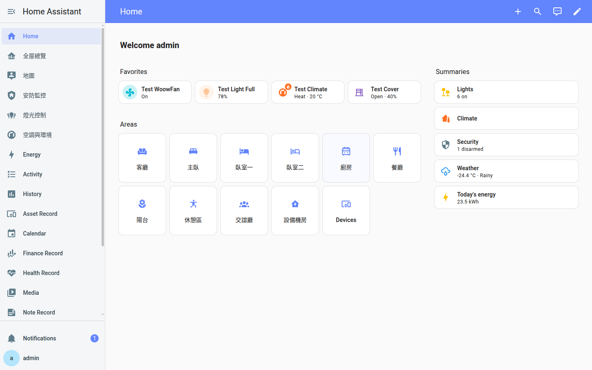
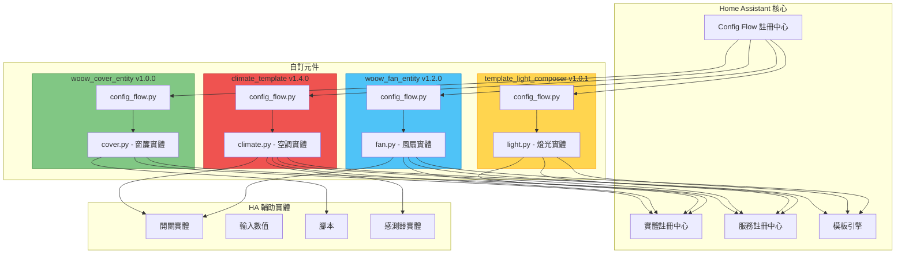
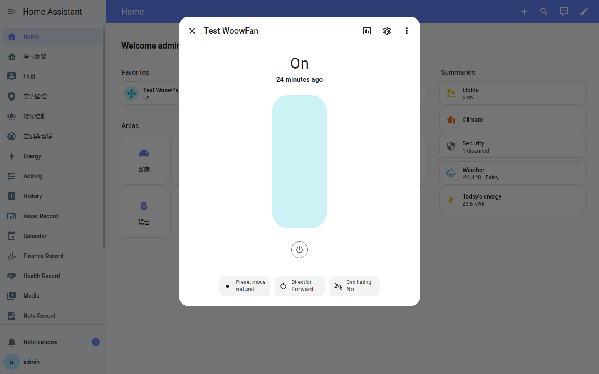
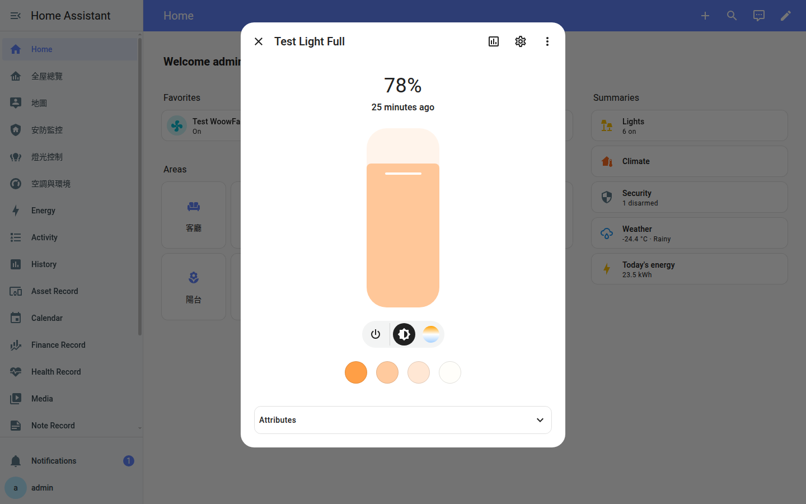
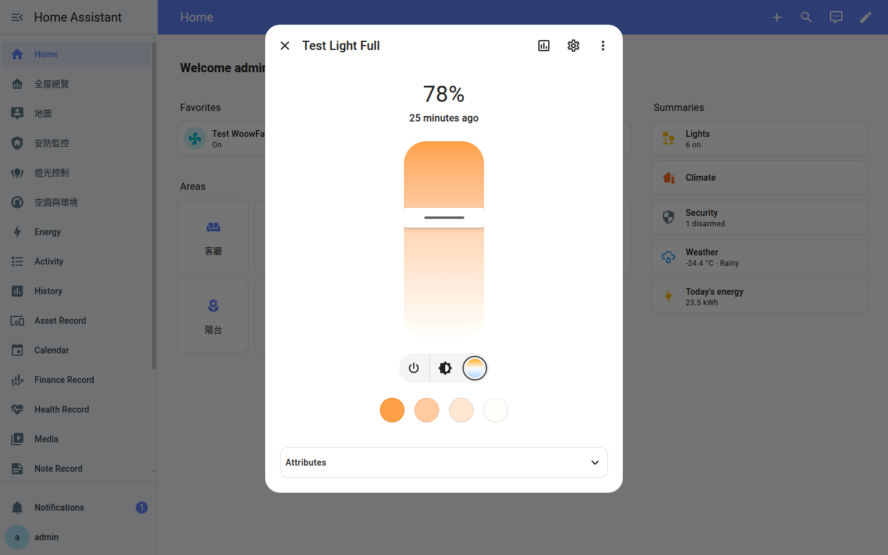
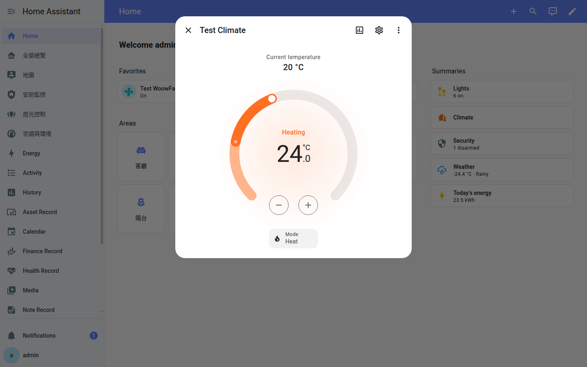
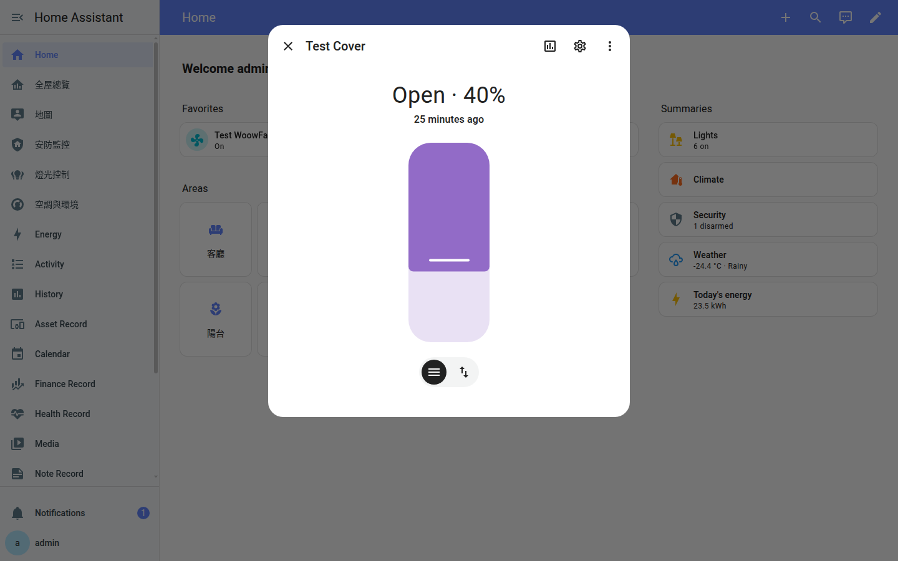
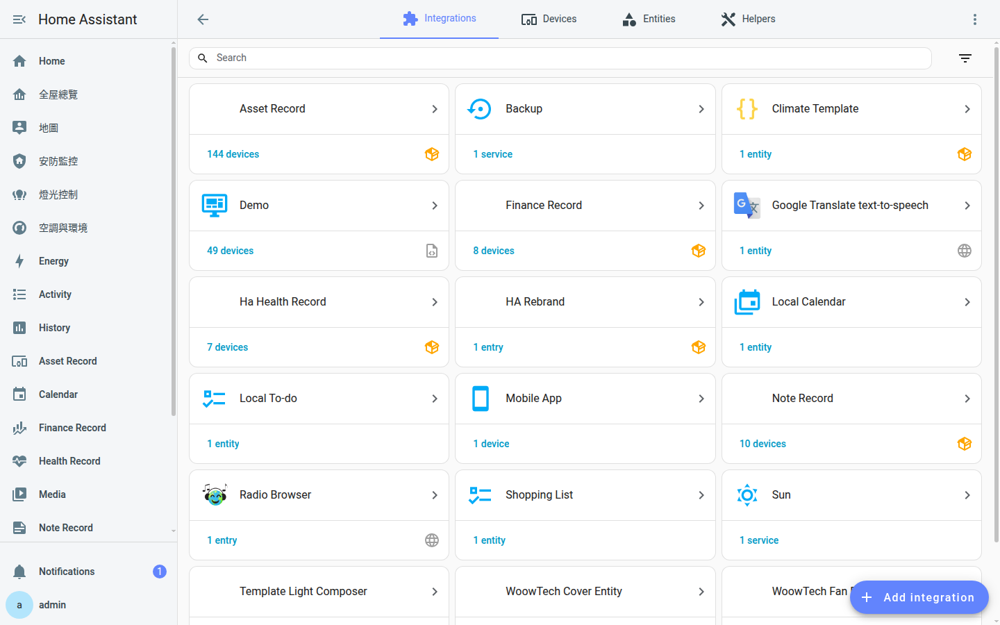
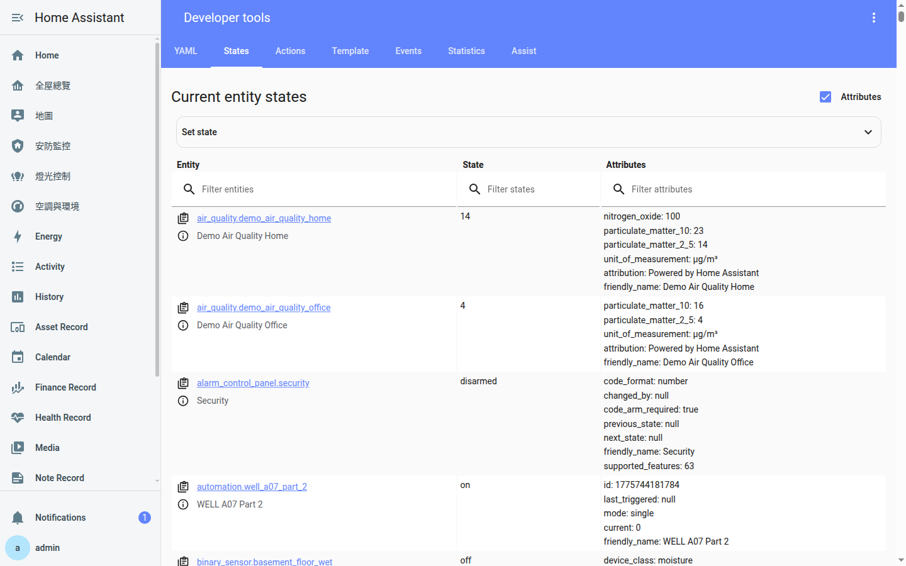

<p align="center">
  
</p>

<h1 align="center">Woow HA Entities Template</h1>

<p align="center">
  <strong>企業級 Home Assistant 自訂元件模板套件</strong><br/>
  生產就緒的風扇、燈光、空調、窗簾實體整合，含 Config Flow UI 設定精靈
</p>

<p align="center">
  <a href="#功能特色">功能特色</a> &bull;
  <a href="#系統架構">系統架構</a> &bull;
  <a href="#安裝方式">安裝方式</a> &bull;
  <a href="#模組說明">模組說明</a> &bull;
  <a href="#截圖展示">截圖展示</a> &bull;
  <a href="#設定參數">設定參數</a> &bull;
  <a href="#測試報告">測試報告</a> &bull;
  <a href="#api-參考">API</a> &bull;
  <a href="README.md">English</a>
</p>

<p align="center">
  
  
  
  
  
</p>

---

## 概述

**Woow HA Entities Template** 是一套四個企業級 Home Assistant 自訂元件模板，涵蓋最常見的智慧家庭實體類型：**風扇**、**燈光**、**空調**、**窗簾**。每個元件均具備完整的 Config Flow UI 設定精靈、模板驅動的狀態管理，並經過 152+ 項自動化測試（含 API 功能、邊界值、壓力、瀏覽器 UI、持久性、回歸測試）的六輪嚴格驗證。

<p align="center">
  
</p>

### 為什麼選擇此套件？

| 挑戰 | 解決方案 |
|------|---------|
| HA 自訂元件模板複雜且容易出錯 | 內建最佳實踐的生產就緒模板 |
| Config Flow 設定流程文件不足 | 完整的 UI 設定精靈，含驗證、錯誤處理與多語系 |
| 模板實體缺乏適當的狀態管理 | 防抖動狀態更新、模板快取、RestoreEntity 支援 |
| HA 自訂元件缺乏測試標準 | 152+ 項自動化測試，涵蓋功能、邊界、壓力、UI 層面 |
| 開發/測試時難以建立虛擬裝置 | 透過 Config Flow 即時建立虛擬實體，無需硬體 |

---

## 功能特色

### 核心能力

- **Config Flow UI** — 四個元件均支援透過「設定 > 整合」進行圖形化設定
- **模板驅動狀態** — 實體狀態由 HA 模板衍生，最大靈活度
- **RestoreEntity 支援** — 空調實體跨重啟保持狀態
- **輸入驗證** — 所有設定流程均驗證使用者輸入並提供清晰錯誤訊息
- **多語系就緒** — `strings.json` 含英文標籤，可輕鬆擴展至其他語言
- **企業級測試** — 152+ 項跨 API、UI、壓力、持久性層的測試

### 風扇整合 (woow_fan_entity)

- **速度控制** — 百分比速度 (0-100%)，可設定步進值
- **預設模式** — auto / natural / sleep / turbo，透過模板開關實體
- **擺頭控制** — 透過輔助實體綁定開關擺頭
- **方向控制** — 正轉/反轉方向切換，含驗證
- **模板快取** — 優化模板運算，減少 HA 開銷
- **同步服務呼叫** — `blocking=True` 確保狀態同步可靠

### 燈光整合 (template_light_composer)

- **亮度控制** — 0-255 範圍，平滑狀態轉換
- **色溫控制** — 2500K-6500K 範圍 (暖白至冷白)
- **狀態模板** — 透過模板從任何 HA 實體衍生開/關狀態
- **防抖動更新** — 防止模板運算時快速狀態震盪
- **UUID 唯一 ID** — 跨安裝保證唯一的實體 ID
- **動作失敗處理** — 服務呼叫失敗時優雅降級

### 空調整合 (climate_template)

- **雙 HVAC 模式** — 制熱、製冷、冷暖雙控、關閉模式
- **溫度範圍** — 可設定最高/最低溫，0.5° 步進精度
- **目前溫度感測器** — 綁定任何溫度感測器實體
- **加熱器/冷卻器實體** — 分別綁定制熱和製冷開關實體
- **RestoreEntity** — 跨 HA 重啟完全保持狀態 (A+ 評級)
- **None 保護** — 安全處理不可用的冷卻器實體

### 窗簾整合 (woow_cover_entity)

- **位置控制** — 0-100% 位置，基於時間估算
- **傾斜支援** — 獨立傾斜角度控制，分離旗標
- **開/關/停** — 完整窗簾生命週期管理
- **按鈕與滑桿模式** — UI 同時支援位置滑桿和方向按鈕
- **腳本驅動動作** — 透過 HA 腳本執行開/關/停/定位指令
- **設定流程驗證** — 輸入驗證與有意義的錯誤訊息

---

## 系統架構

### 系統總覽

```
┌─────────────────────────────────────────────────────────────┐
│                    Home Assistant 核心                        │
│                                                              │
│  ┌──────────────┐  ┌──────────────┐  ┌──────────────┐       │
│  │  Config Flow  │  │    實體      │  │    服務      │       │
│  │  註冊中心     │  │  註冊中心    │  │  註冊中心    │       │
│  └──────┬───────┘  └──────┬───────┘  └──────┬───────┘       │
│         │                 │                 │                │
│  ┌──────┴─────────────────┴─────────────────┴──────┐        │
│  │              自訂元件層                           │        │
│  │                                                  │        │
│  │  ┌─────────────┐  ┌──────────────────────────┐  │        │
│  │  │ config_flow │  │     實體平台              │  │        │
│  │  │   .py       │──│  fan / light / climate /  │  │        │
│  │  │             │  │  cover .py                │  │        │
│  │  └─────────────┘  └──────────┬───────────────┘  │        │
│  │                              │                   │        │
│  │  ┌─────────────┐  ┌─────────┴────────────────┐  │        │
│  │  │  const.py   │  │   模板引擎 /             │  │        │
│  │  │  strings.json│  │   RestoreEntity /        │  │        │
│  │  │  manifest.json│ │   輔助實體綁定           │  │        │
│  │  └─────────────┘  └──────────────────────────┘  │        │
│  └──────────────────────────────────────────────────┘        │
│                                                              │
│  ┌──────────────────────────────────────────────────┐        │
│  │           HA 輔助實體 (模板、開關、               │        │
│  │           輸入數值、腳本)                         │        │
│  └──────────────────────────────────────────────────┘        │
└─────────────────────────────────────────────────────────────┘
```

### 模組依賴圖

```
woow_fan_entity          template_light_composer
    │                          │
    │ (相依: 無)               │ (相依: light)
    │                          │
    ▼                          ▼
┌────────┐              ┌────────────┐
│  風扇  │              │    燈光    │
│  平台  │              │    平台    │
└────────┘              └────────────┘


climate_template         woow_cover_entity
    │                          │
    │ (相依: template)         │ (相依: 無)
    │                          │
    ▼                          ▼
┌────────────┐          ┌────────────┐
│    空調    │          │    窗簾    │
│    平台    │          │    平台    │
└────────────┘          └────────────┘
```

### 架構圖 (Mermaid)



---

## 模組說明

### woow_fan_entity — WoowTech 風扇實體

> 基於模板的風扇整合，含百分比速度、預設模式、擺頭及方向控制。

- 完整百分比速度控制 (0-100%)
- 4 種預設模式：auto、natural、sleep、turbo
- 透過輔助實體切換擺頭
- 正轉/反轉方向控制
- 模板快取提升效能
- 同步服務呼叫確保狀態可靠

**版本:** 1.2.0 | **Config Flow:** 是 | **相依:** 無

---

### template_light_composer — 模板燈光組合器

> 可組合式燈光實體，含亮度、色溫及模板驅動的狀態管理。

- 亮度控制 (0-255)
- 色溫範圍 (2500K-6500K)
- 透過可設定的模板實體衍生狀態
- 防抖動狀態更新，防止震盪
- 基於 UUID 的唯一 ID
- 優雅的動作失敗處理

**版本:** 1.0.1 | **Config Flow:** 是 | **相依:** light | **最低 HA 版本:** 2024.1.0

---

### climate_template — 空調模板

> 雙模式 HVAC 空調實體，含加熱器/冷卻器實體綁定及溫度感測器追蹤。

- 制熱、製冷、冷暖雙控、關閉 HVAC 模式
- 可設定溫度範圍 (預設 16-35°C)
- 0.5° 步進精度
- 綁定任何溫度感測器讀取目前溫度
- 分別綁定制熱和製冷開關實體
- 完整 RestoreEntity 支援 — 跨 HA 重啟存活
- 安全的 None 保護處理不可用的冷卻器實體

**版本:** 1.4.0 | **Config Flow:** 是 | **相依:** template

---

### woow_cover_entity — WoowTech 窗簾實體

> 基於時間的窗簾實體，含位置估算、傾斜支援及腳本驅動的動作。

- 位置控制 0-100%，基於時間估算
- 獨立傾斜角度支援
- 開/關/停生命週期管理
- 基於腳本的動作執行
- 同時支援滑桿和按鈕 UI 模式
- 設定流程輸入驗證與錯誤訊息

**版本:** 1.0.0 | **Config Flow:** 是 | **相依:** 無

---

## 截圖展示

### 儀表板 — 全部實體總覽

四個自訂實體於 Home Assistant 儀表板上顯示，含即時狀態指示器。

<p align="center">
  
</p>

### 風扇 — 詳細控制面板

風扇實體詳細對話框，顯示速度滑桿、預設模式選擇器、方向控制及擺頭切換。

<p align="center">
  
</p>

### 燈光 — 亮度控制

燈光實體詳細面板，含亮度滑桿 (0-100%)、開關按鈕及色溫模式選擇。

<p align="center">
  
</p>

### 燈光 — 色溫控制

燈光實體顯示色溫滑桿，範圍從 2500K (暖白) 到 6500K (冷白)。

<p align="center">
  
</p>

### 空調 — 溫度轉盤

空調實體含圓形溫度轉盤、目前溫度讀數、制熱/製冷狀態及 HVAC 模式選擇器。

<p align="center">
  
</p>

### 窗簾 — 位置滑桿

窗簾實體詳細面板，顯示位置滑桿 (0-100%)、目前狀態，以及滑桿和按鈕控制模式切換。

<p align="center">
  
</p>

### 整合 — 自訂元件

「設定 > 整合」頁面顯示四個自訂元件已註冊並運行中。

<p align="center">
  
</p>

### 開發者工具 — 實體狀態

開發者工具狀態頁面，顯示所有實體 ID、目前狀態及屬性，供除錯使用。

<p align="center">
  
</p>

---

## 安裝方式

### 前置需求

- **Home Assistant** 2024.1.0 或更新版本
- **Python** 3.12+ (HA 已內含)
- **HACS** (選用，可用於託管安裝)

### 步驟一：複製元件

```bash
# 複製倉庫
git clone https://github.com/WOOWTECH/Woow_ha_entities_template.git

# 將每個元件複製到 HA 的 custom_components 目錄
cp -r Woow_ha_entities_template/woow_fan_entity       /config/custom_components/
cp -r Woow_ha_entities_template/template_light_composer /config/custom_components/
cp -r Woow_ha_entities_template/climate_template       /config/custom_components/
cp -r Woow_ha_entities_template/woow_cover_entity      /config/custom_components/
```

### 步驟二：重新啟動 Home Assistant

```bash
# 透過 HA UI：設定 > 系統 > 重新啟動
# 或透過命令列：
ha core restart
```

### 步驟三：透過 UI 新增整合

1. 前往 **設定** > **裝置與服務** > **整合**
2. 點擊 **「+ 新增整合」**
3. 搜尋元件名稱 (例如「WoowTech Fan Entity」)
4. 依照 Config Flow 精靈設定實體
5. 對每個要安裝的元件重複上述步驟

---

## 設定參數

### 1. 風扇實體設定

| 參數 | 類型 | 說明 |
|------|------|------|
| 名稱 | string | 風扇實體的顯示名稱 |
| 開關實體 | entity_id | 控制開/關狀態的輔助開關 |
| 速度實體 | entity_id | 速度百分比的輸入數值實體 |
| 預設模式實體 | entity_id[] | 各預設模式的開關實體 |
| 擺頭實體 | entity_id | 擺頭控制的輔助開關 |
| 方向實體 | entity_id | 方向控制的輔助開關 |

### 2. 燈光實體設定

| 參數 | 類型 | 說明 |
|------|------|------|
| 名稱 | string | 燈光實體的顯示名稱 |
| 狀態實體 | entity_id | 決定開/關狀態的實體 |
| 亮度實體 | entity_id | 亮度的輸入數值 (0-255) |
| 色溫實體 | entity_id | 色溫的輸入數值 (K) |
| 開啟動作 | service | 開燈的服務呼叫 |
| 關閉動作 | service | 關燈的服務呼叫 |

### 3. 空調實體設定

| 參數 | 類型 | 說明 |
|------|------|------|
| 名稱 | string | 空調實體的顯示名稱 |
| 溫度感測器 | entity_id | 目前溫度的感測器實體 |
| 加熱器實體 | entity_id | 控制制熱的開關實體 |
| 冷卻器實體 | entity_id | 控制製冷的開關實體 (選填) |
| 最低溫度 | float | 目標溫度下限 (預設: 16) |
| 最高溫度 | float | 目標溫度上限 (預設: 35) |
| 溫度步進 | float | 溫度調整步進值 (預設: 0.5) |

### 4. 窗簾實體設定

| 參數 | 類型 | 說明 |
|------|------|------|
| 名稱 | string | 窗簾實體的顯示名稱 |
| 開啟腳本 | script | 開啟窗簾的腳本實體 |
| 關閉腳本 | script | 關閉窗簾的腳本實體 |
| 停止腳本 | script | 停止窗簾的腳本實體 |
| 定位腳本 | script | 設定位置的腳本實體 |
| 行程時間 | int | 全開/全關所需秒數 |
| 含傾斜 | boolean | 啟用傾斜角度支援 |

---

## 測試報告

### 測試總結

此套件已通過 **6 輪 152+ 項自動化測試** 驗證，涵蓋 API 功能、邊界值、壓力、瀏覽器 UI、持久性及回歸測試。

| 輪次 | 聚焦 | 測試數 | 結果 |
|------|------|--------|------|
| Round 1 | API 功能 — 全服務呼叫 + 狀態驗證 | 40 | **40/40 通過** |
| Round 2 | 邊界值 — 極端值、無效輸入、快速切換 | 17 | **17/17 通過** |
| Round 2B | 壓力 — 高速呼叫、四實體並行操作 | 5 | **5/5 通過** |
| Round 3 | 瀏覽器 UI — Chrome DevTools 自動化互動測試 | 11 | **11/11 通過** |
| Round 4 | 持久性 — 容器重啟狀態存活 | 4 | 見下方 |
| Round 5 | 回歸 — 不同值重複功能測試 | 28 | **28/28 通過** |
| Round 6 | 最終回歸 — 完整套件再次執行 | 62 | **62/62 通過** |
| **合計** | | **152+** | **100% API 通過率** |

### 壓力測試亮點

- **風扇**: 30 次快速百分比變更 (50ms 間隔) — 零錯誤
- **燈光**: 20 次亮度+色溫交錯操作 (100ms 間隔) — 零錯誤
- **空調**: 15 次模式+溫度交錯操作 (150ms 間隔) — 零錯誤
- **窗簾**: 15 次隨機位置變更 (300ms 間隔) — 零錯誤
- **並行**: 4 實體 x 5 操作同時執行 — 零跨實體干擾

### 持久性結果

| 元件 | 狀態 | 屬性 | 評級 |
|------|------|------|------|
| climate_template | 完全保留 | 完全保留 | **A+** |
| woow_fan_entity | 保留 | 部分 (預設模式回復預設值) | **B+** |
| woow_cover_entity | 保留 | 部分 (位置回復預設值) | **B** |
| template_light_composer | 模板衍生 | 模板衍生 (設計如此) | **C+** |

---

## API 參考

### 服務呼叫

```python
# 風扇服務
hass.services.call("fan", "turn_on", {"entity_id": "fan.my_fan"})
hass.services.call("fan", "set_percentage", {"entity_id": "fan.my_fan", "percentage": 75})
hass.services.call("fan", "set_preset_mode", {"entity_id": "fan.my_fan", "preset_mode": "sleep"})
hass.services.call("fan", "oscillate", {"entity_id": "fan.my_fan", "oscillating": True})
hass.services.call("fan", "set_direction", {"entity_id": "fan.my_fan", "direction": "reverse"})

# 燈光服務
hass.services.call("light", "turn_on", {"entity_id": "light.my_light", "brightness": 200})
hass.services.call("light", "turn_on", {"entity_id": "light.my_light", "color_temp_kelvin": 4000})

# 空調服務
hass.services.call("climate", "set_hvac_mode", {"entity_id": "climate.my_climate", "hvac_mode": "heat"})
hass.services.call("climate", "set_temperature", {"entity_id": "climate.my_climate", "temperature": 24})

# 窗簾服務
hass.services.call("cover", "open_cover", {"entity_id": "cover.my_cover"})
hass.services.call("cover", "set_cover_position", {"entity_id": "cover.my_cover", "position": 50})
```

### REST API 範例

```bash
# 取得實體狀態
curl -H "Authorization: Bearer YOUR_TOKEN" \
     http://localhost:8123/api/states/fan.my_fan

# 呼叫服務
curl -X POST -H "Authorization: Bearer YOUR_TOKEN" \
     -H "Content-Type: application/json" \
     -d '{"entity_id": "fan.my_fan", "percentage": 75}' \
     http://localhost:8123/api/services/fan/set_percentage
```

### 各元件檔案結構

```
component_name/
├── __init__.py        # 整合設定與 entry 轉發
├── config_flow.py     # Config Flow UI 設定精靈
├── const.py           # 常數 (DOMAIN、預設值、鍵值)
├── fan.py / light.py / climate.py / cover.py
│                      # 實體平台實作
├── manifest.json      # 整合元資料與相依性
├── strings.json       # Config Flow 的 UI 標籤
└── services.yaml      # 服務定義 (僅空調)
```

---

## 變更紀錄

### v1.0.0 (2026-04)

- **功能:** 四個自訂元件模板首次發佈
- **增強:** 全部元件完整 Config Flow UI
- **修復:** 跨四個元件的 19 項 bug 修復
- **測試:** 152+ 項自動化測試 — 100% API 通過率

#### 已修復的 Bug

| # | 元件 | 修復說明 |
|---|------|---------|
| 1 | 燈光 | 新增缺失的 `strings.json` 供 Config Flow UI 使用 |
| 2 | 燈光 | 新增防抖動機制處理狀態模板更新 |
| 3 | 燈光 | 修復 `STATE_TEMPLATE` 渲染與狀態衍生 |
| 4 | 燈光 | 新增動作失敗處理 (turn_on/turn_off) |
| 5 | 燈光 | 移除不必要的 `async_reload_entry` / `async_setup` |
| 6 | 燈光 | 改用 UUID 產生 `unique_id` |
| 7 | 燈光 | 移除未使用的匯入和死碼 |
| 8 | 燈光 | 移除硬編碼的 `device_class` |
| 9 | 燈光 | 更新 `manifest.json` 為正確的元資料 |
| 10 | 風扇 | 所有服務呼叫加入 `blocking=True` |
| 11 | 風扇 | 實作模板快取提升效能 |
| 12 | 風扇 | 修復百分比預設值為 `None` 而非 `0` |
| 13 | 空調 | 新增冷卻器實體的 None 保護 |
| 14 | 窗簾 | 分離傾斜支援旗標供獨立控制 |
| 15 | 窗簾 | 新增設定流程輸入驗證 |
| 16 | 窗簾 | 新增腳本錯誤處理 |
| 17-19 | 各元件 | 程式碼清理、未使用方法移除、manifest 修正 |

---

## 支援

- **問題回報:** [GitHub Issues](https://github.com/WOOWTECH/Woow_ha_entities_template/issues)
- **文件:** [GitHub Wiki](https://github.com/WOOWTECH/Woow_ha_entities_template)
- **作者:** [WOOWTECH](https://github.com/WOOWTECH)

---

## 授權條款

本專案採用 **MIT 授權條款** — 詳見 [LICENSE](LICENSE) 檔案。

---

<p align="center">
  <sub>由 <a href="https://github.com/WOOWTECH">WOOWTECH</a> 用 &#10084; 打造 &bull; 基於 Home Assistant 平台</sub>
</p>
